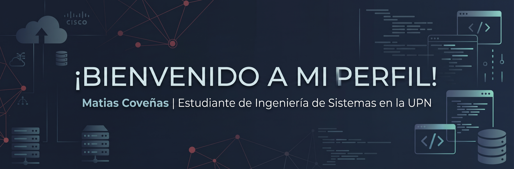

### 👋 ¡Hola! Soy Matias Coveñas

<!-- Banner de Imagen -->

  

 

### 🚀 Sobre mí
---
🎓 **Educación y Perfil**
* Estudiante de 8vo ciclo de **Ingeniería de Sistemas Computacionales** en la Universidad Privada del Norte (UPN).
* Cuento con un **perfil técnico híbrido** orientado a la administración de infraestructura, redes empresariales y desarrollo de software full stack.

💡 **Áreas de Enfoque**
* **Infraestructura Cloud & Servidores:** Experimentado en monitoreo y soporte de servicios sobre **AWS** (EC2) y **Huawei Cloud**, administración de entornos **Windows Server** y **Linux** (Ubuntu/CentOS), así como soluciones de virtualización con **Apache Guacamole**.
* **Redes y Comunicaciones:** Configuración de topologías de red simuladas en **Cisco IOS**, trabajando con switching, ruteo (IPv4/IPv6), VLANs y políticas de seguridad.
* **Desarrollo Full Stack:** Construcción de aplicaciones web utilizando **Java (Spring Boot)** con JPA/Hibernate en el backend y **Angular** con Reactive Forms en el frontend, gestionando bases de datos relacionales como **MySQL**, **SQL Server** y **Oracle**.

🛠️ **Proyectos y Metodologías**
* Aplicación de buenas prácticas de control de versiones con **Git/GitHub** y contenedorización básica con **Docker**.
* Experiencia en operaciones TI con **Jira Service Management**, aplicando triaje ágil y soporte preventivo.

 

### 💼 Tech Stack
---

  <!-- Cloud, Servidores & Virtualización -->
  
  
  
  
  

  <!-- Desarrollo & Frameworks -->
  
  
  
  
  
  
  

  <!-- Bases de Datos -->
  
  
  

  <!-- Herramientas -->
  
  
  
  
  

 

### 🌐 Conecta conmigo
---

  

   <b>matiascove178@gmail.com</b>

